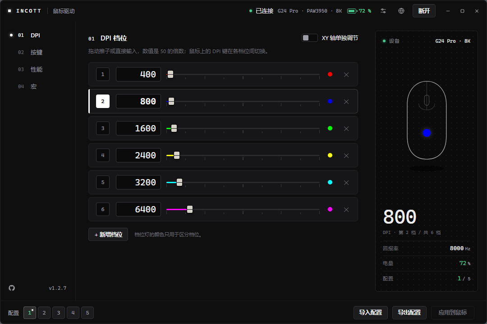
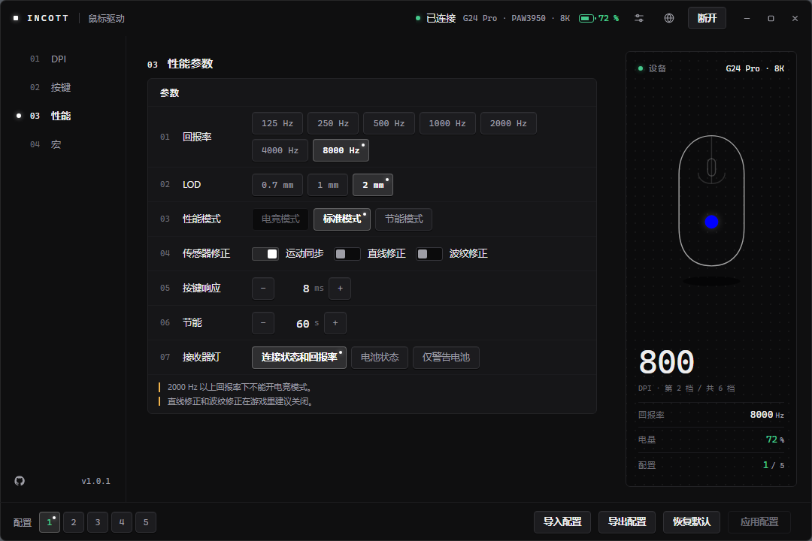
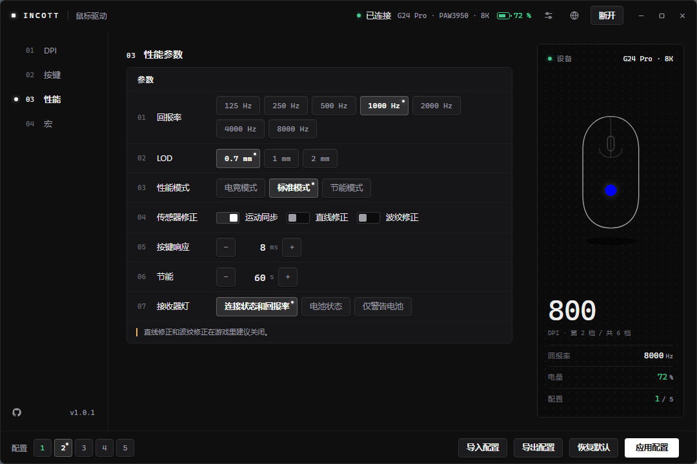

# Incott Mouse Driver（Tauri 版）

因科特（Incott）鼠标的独立桌面配置工具——基于逆向的 HID 协议，不依赖官方网页驱动。
因科特官网已停止运营、网页驱动下线，本工具让已售出的鼠标继续可配置。

本项目基于 [HeHaoren/incott-mouse-app](https://github.com/HeHaoren/incott-mouse-app)（MIT 许可，Electron 版）
优化改造，用 **Tauri 2** 重做了外壳和界面：系统 WebView2 + Rust，安装包约 **1.4 MB**（不随包带浏览器内核）。
界面在 2026-11 整体重做过，风格是「单色仪表台」——设计原则见 [`ui/style.css`](ui/style.css) 开头，
动效原则和逐处清单、选型过程与工具见 [design/](design/README.md)。
哪些来自原项目、哪些是本项目的改动，见文末「来源与许可」。



## 功能

- **DPI 档位**：最多 6 档，推子或直接输入，XY 轴可分离
- **按键映射**：6 个按键 × 系统按键 / 键盘 / 多媒体 / 宏
- **性能参数**：回报率（最高 8000Hz）、LOD、性能模式、运动同步、直线/波纹修正、按键响应、节能、接收器灯
- **宏**：10 个槽位，上传到鼠标，官方 `.icm` 格式互导
- **配置**：5 份 PC 端预设，官方 `.ict` 格式互导
- **常驻读数屏**：显示鼠标当前实际的档位、DPI、回报率、电量、配置
- **托盘**：图标是一只带指示灯的鼠标，灯的颜色表示连接和电量（灭 = 未连接，绿 / 黄 / 红 = 电量）；单击弹出读数浮层，双击打开主界面
- 设备主动上报：电量 / DPI 切换 / 回报率 / 配置切换实时推送，界面跟着鼠标走
- 中英文界面

| 性能参数 | 有未应用的修改 |
|---|---|
|  |  |

兼容条件：VID `0x093A`（PixArt）+ vendor-defined 接口（usagePage `0xFF05`），
不限制 PID——Ghero / G23 / G23V2 / G24 / G24 Pro / Zero 等同协议机型理论上均可用。

**G24 与 G24 Pro 怎么区分**：两者的 USB 枚举信息完全一样（都是通用的 8K 接收器字符串），
固件也只报「G24 系列」这一个代码。唯一的差别是传感器——型号信息里带 PAW3950 的是 G24 Pro，
带 PAW3395 的是原版 G24。标题栏和读数屏按这个规则显示 `G24 Pro`，区分依据和实测数据见
[docs/protocol.md](docs/protocol.md) §1。

## 交互模型

界面区分两份状态：**正在编辑的值**（界面上的按键、推子指向它）和**鼠标当前实际生效的值**。

- 改任何设置都不立即写鼠标。底栏显示「几项未应用」，有修改时「应用到鼠标」才点亮。
- 右侧读数屏显示的是**鼠标上实际生效的值**，不是编辑中的值——改了没应用，读数屏不会变。
- 配置键：白灯 = 正在编辑，**绿数字** = 鼠标正在运行（两者在同一键上时就是白灯配绿数字）。
  点配置键只是换一份预设来编辑；读数屏和托盘浮层上的配置序号用的是同一个记号。
- 鼠标上按 DPI 键换了档位时，如果没有待应用的修改，界面（读数屏、DPI 页的当前档）跟着变，
  并且不算作「未应用」。
- 鼠标上的物理配置切换键仍然是立即生效（硬件只改序号，由本工具把对应预设整套灌入）。

## 安装

到 [Releases](https://github.com/magnum-qin/incott-mouse-driver/releases/latest) 下载安装包
（`Incott.Mouse.Driver_x.y.z_x64-setup.exe`，约 1.4 MB），双击安装。仅支持 Windows 10 / 11；
需要 WebView2 运行时（Windows 11 自带，缺少时安装包会联网下载）。想自己编译见下面「开发」。

## 开发

前置要求：Node 18+、Rust（MSVC 工具链）、VS Build Tools（C++ 工作负载）、WebView2（Win10/11 自带）。

```bash
npm install        # 只装 @tauri-apps/cli，前端零依赖零构建
npm test           # node --test，54 项：协议层、配置格式、键位显示名、文案键一致性与引用审计、图标一致性审计
npm run dev        # 开发模式
npm run build      # 产出 NSIS 安装包（src-tauri/target/release/bundle/nsis/）
```

改界面不用插鼠标也不用打包——预览环境把真实界面跑在模拟数据上：

```bash
node design/preview/serve.mjs
# 打开 http://127.0.0.1:4173/design/preview/index.html
```

连真实鼠标做**只读**检查（只读不写）见 [design/README.md](design/README.md) 的 `live.mjs` / `raw.mjs`。

## 架构

上游三层：Electron 主进程（node-hid + 业务编排）→ preload 桥接 → 渲染层（纯浏览器 JS）。
本版把中间两层合并进了前端，界面层则完全重写：

```
ui/                          ← 前端（frontendDist，纯静态无构建工具）
├── index.html               ← 页面结构：标题栏 / 编号菜单 / 四个页面 / 读数屏 / 底栏
├── style.css                ← 设计系统（令牌 + 全部样式）
├── app.js                   ← 界面逻辑：渲染、事件、未应用指示、读数屏
├── popover.html|js|css      ← 托盘读数浮层
├── shared/                  ← 协议层与文案（纯函数，单测覆盖）
│   ├── protocol.js          ← HID 协议（上游原样 ESM 化，Buffer→Uint8Array）
│   ├── config-format.js     ← .ict / .icm 导入导出
│   ├── i18n.js              ← 中英文案
│   └── keynames.js          ← 键位显示名
└── bridge/                  ← 上游「主进程 + preload」的浏览器版
    ├── core.js              ← 设备生命周期、EXEC/READ 分发表、HID 时序、托盘状态
    ├── misc.js              ← 设置 / 导入导出 / 窗口控制 / i18n 胶水
    ├── main-init.js         ← 组装 window.api/i18n/keynames + 标题栏拖拽
    └── popover-init.js      ← 浮层窗口的 API 子集

src-tauri/src/               ← Rust（只做传输与系统能力，无业务逻辑）
├── hid.rs                   ← hidapi 薄封装：枚举/打开/探测/单 IO 线程串行读写 + 事件
├── tray.rs                  ← 托盘：现画的鼠标图标（指示灯表示状态）、单击/双击区分、浮层定位、菜单
├── settings.rs              ← settings.json、注册表自启、文件对话框、系统通知
└── main.rs                  ← 窗口/事件接线、--background 静默启动、close→hide
```

关键设计：**协议命令构造与全部写入时序（sleep 45~200ms、读回验证、串行队列）保留在 JS**，
Rust 只提供原始 HID 读写（`hid_send_feature / hid_get_feature / hid_write_output`）
与 `hid://data`、`hid://error` 事件——字节布局与 node-hid 完全一致，
上游经实机验证的协议行为和单测继续有效。

### 与上游的差异

| | 说明 |
|---|---|
| 界面 | 完全重写。上游是紫色发光的卡片式界面；本版是单色仪表台：编号菜单、指示灯、等宽数字、推子、带灯按键、读数屏 |
| 图标 | 重做。上游是紫色渐变底 + 深紫色鼠标；本版是石墨灰底、白色鼠标、一枚绿色连接灯，和应用内的设计语言一致。安装包的图标也换成了应用图标（上游没配置，显示的是安装器自带的通用图标）。小尺寸（16~48 像素）的几帧单独画得比较粗，在任务栏里和旁边的图标分量相当 |
| 托盘图标 | 上游是一枚 16×16 的彩色圆点（未连接时是蓝色）。本版是同一只鼠标，用指示灯表示状态，灭 = 未连接；并且按屏幕缩放出图（150% 缩放的屏幕上是 24 像素），不会被系统拉伸发虚 |
| 窗口控制键 | 上游是贴着窗口顶边的直角热区。本版和界面里其它按键是同一种键：垂直居中，悬停亮起键面，按下有行程 |
| 动效 | 新增。上游到处是硬切（换页、换按键组、换槽位、显隐）。本版有一套统一的原则：按键有行程、灯有亮灭、读数不变；换页先出后进；列表先消失再补位；进出成对。逐处清单见 [design/README.md](design/README.md)「动效」 |
| 型号识别 | 上游只显示到系列（`G24`）。本版按传感器细分：G24 系列里带 PAW3950 的显示为 `G24 Pro` |
| 未应用指示 | 新增。底栏显示与鼠标不一致的参数有几项，没有修改时「应用到鼠标」熄灭 |
| 读数屏 | 新增。常驻显示鼠标实际生效的档位 / DPI / 回报率 / 电量 / 配置 |
| 板载配置 | 点配置键只换一份预设来编辑，点「应用到鼠标」才整套写入（上游是点击即写入） |
| 灯效 | 并入性能参数的最后一行，不再是独立页面（上游只有一个三选一设置却占一个标签页） |
| 说明文字 | 每个控件下的大段说明去掉了，只留必要的一两句，其余放悬停提示 |
| 自动更新 | 移除。上游指向作者的 GitHub Releases，下载的是 Electron 安装包 |
| 标题栏拖拽 | Electron 的 `-webkit-app-region` 不适用，改为 `main-init.js` 里 mousedown → `startDragging()` |
| 自启注册表项 | `HKCU\…\Run\IncottMouseDriver`（上游键名不同，两者可共存） |
| 卸载 | 用 Tauri NSIS 自带卸载器 |
| DPI 切换提示 | 窗口不可见时改用 Windows 系统通知（上游是托盘气泡） |

修掉的上游 bug：托盘浮层的 DPI 数值一直是「--」——读档位 DPI 和回报率后，判断回显时写成了
写命令码 `0x02` / `0x01`，而读命令的回显是 `0x82` / `0x81`。

本版自己修掉的（都藏在「平时不会那样点」的路径里，是逐帧录动效时暴露出来的）：

- 删掉当前档**前面**的某一档，「当前档」会悄悄跳到下一档（序号变了，指向的 DPI 也跟着变）。
- 「XY 轴单独调节」开关和实际状态会对不上：从本地配置载入一份带 XY 分离的预设后，每一档分成了 X / Y 两行，
  开关却显示关着。现在开关始终跟着状态走。
- 按键被点的时候整颗键（连文字一起）提亮、缩放。现在只有外壳闪一下，文字不动。
- 连点菜单时换页会多等一轮、或者两段动画互相盖掉；现在每段动画都从当前看到的样子接着走。
- 删一行时残影和上滑的行叠成重影、列表下方的按钮先跳到位。

还有一个是在真实任务栏上逐像素比对才看出来的：托盘图标一直按 33 像素画、再被系统缩到 24 显示——
取尺寸用错了系统指标，图标比设计的细而且发糊。现在按任务栏所在屏幕的缩放算，屏幕上的图标和代码画的逐像素一致。

## 实测情况

在 G24 Pro + 8K 接收器（无线）上做过**只读**验证：连接、读回整套配置、读数屏、未应用指示、
托盘浮层都正常，界面无异常。协议细节和实测数据见 [docs/protocol.md](docs/protocol.md)。

两点需要知道：

- **写入路径沿用上游逻辑，没有改动，本轮也没有在真机上验证**——只读检查不往鼠标里写东西。
- 这只鼠标在无线模式下，主动读电量的命令（`0x89`）回显正确但**不带电量**，
  电量全部来自设备的主动上报。所以连接后电量要等第一次上报才出现（约两秒）。

## 实机调试提示

- 有线模式插线时会出现 Col01/Col02 两个接口，**Col01 发 Feature Report 会失败**——
  打开逻辑按「枚举倒序（Col02 优先）→ 逐个探测 → 失败强制重新枚举重试」处理，无需手动插拔。
- 有线 / 非 8K 接收器上 2000Hz+ 会被固件钳制到 1000Hz，应用层已提前钳制。

## 来源与许可

本项目基于 [HeHaoren/incott-mouse-app](https://github.com/HeHaoren/incott-mouse-app) 改造而来，
感谢原项目逆向并整理了 HID 协议。原项目在它的 `package.json` 里声明为 MIT 许可（仓库里没有单独的许可文件）。

| 内容 | 来源 |
|---|---|
| HID 协议层、配置格式（`.ict` / `.icm`）、键位名称、单元测试 | 原项目（改成 ES 模块，协议层把 `Buffer` 换成了 `Uint8Array`） |
| 与设备通信的流程（`ui/bridge/`）、中英文案 | 原项目主进程的浏览器版；文案在新界面里有增删 |
| 协议文档（`docs/`） | 原项目，本项目补充了 G24 Pro 的识别依据 |
| Tauri 外壳（Rust）、界面、图标、动效、设计工具（`design/`） | 本项目 |

本项目沿用 MIT 许可发布，全文见 [LICENSE](LICENSE)。相对原项目改了什么，见上面「与上游的差异」。

## 免责声明

本项目通过逆向工程分析官方网页驱动的通信协议实现，仅供个人学习与设备配置用途。
不包含任何官方软件的代码或资源，与因科特（Incott）官方无关。
